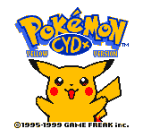

# Cam's Yellow Decapitalization+

    

(this title screen is only in the "Plus" version of the patch)

A hack of Pokémon Yellow (forked from pret's pokeyellow decompilation) which started from a decapitalization, and is slowly spiralling out of my control. Help.

There are three patches:

- **Cam's Yellow Decapitalization+** (CYD+_v`n.n`.bps) - The full hack with all the bells and whistles
    - **Spaceworld '97 Sprites Addon** (CYD+_v`n.n`_+SW.bps) - Apply this on top of the main patch to replace sprites with art from the G/S Spaceworld 1997 demo
- **Cam's Yellow Decapitalization-** (CYD-_v`n.n`.bps) - Just the decapitalization

Patching requires a ROM of Pokémon Yellow (CRC32: `7d527d62`). I recommend using [Rom Patcher JS](https://www.marcrobledo.com/RomPatcher.js/) if you don't feel like downloading any software.

## Features
### Decapitalization and terminology tweaks
God I hope so, it's the title. Additionally, some terms have been adjusted to suit my personal taste (which mostly means using the modern spellings of them when possible).

Some examples of what to expect:
- PARLYZ HEAL -> ParalyzeHeal
- PROF.OAK -> Prof. Oak
- HI JUMP KICK -> HighJumpKick
- VICEGRIP -> Vise Grip

### Gender
You can be a girl now. :thumbsup:

Dialogue is either adjusted based on your gender, or neutralized (hopefully without losing the original intent too much!). You can change your gender any time at any Pokémon Center by talking to your favorite cis ally, the Gym Guide.

### Various quality-of-life

- **Running Shoes** - Hold B to run. Doesn't have any of the other bells and whistles that some other versions do (i.e. you can't "run" on the bike or while Surfing)
- **Double-speed Surfing**
- **Overworld HM Use**
- **Pikachu's Beach Without a Surfing Pikachu**
- **Gendered Pokémon** - No gameplay effect, but should be accurate for gen 2 transfers (tested with my team from my main file)
- **"Already Caught" Icon**
- **Shiny Pokémon** - Also just visual, but should also be accurate for gen 2 transfers. Includes a shiny icon in-battle and in menus for DMG players

### GS Spaceworld '97 Sprites (Optional)

This is supplied as an extra patch to be applied on top of a ROM patched with CYD+

### No bugfixes unless absolutely necessary

I believe that the jank is a core part of gen 1's identity, so I won't be fixing bugs unless I *need* to in order to implement another feature.

## Branches

### `master`

Main branch with all features

### `sw97art`

Spaceworld '97 sprites branch

### `minus`

The decapitalization alone

## Credits
### General
- Tutorials from the pokered wiki were referenced in implementing various features
### Gender
- Leaf's sprites made by yesilovenachos and OmegaZeeZ, sourced from [The Spriters' Resource](https://www.spriters-resource.com/custom_edited/pokemongeneration1customs/asset/228623/)

#  Generative AI was not (and will never be) used in this repository.
AI-generated or AI-assisted contributions to any of my repositories are strictly prohibited, and will be turned away as quickly as possible.
